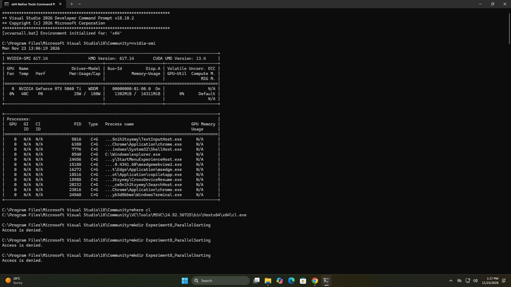
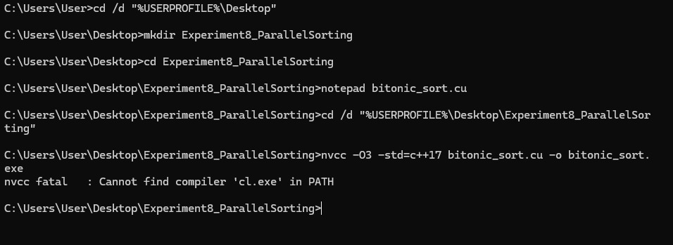
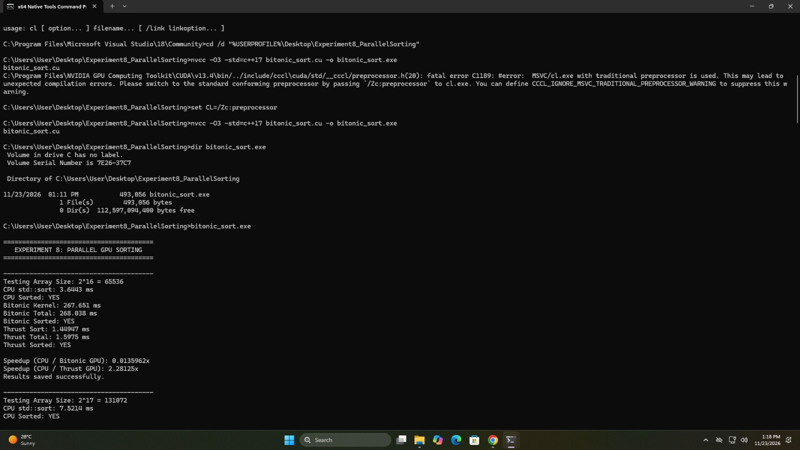
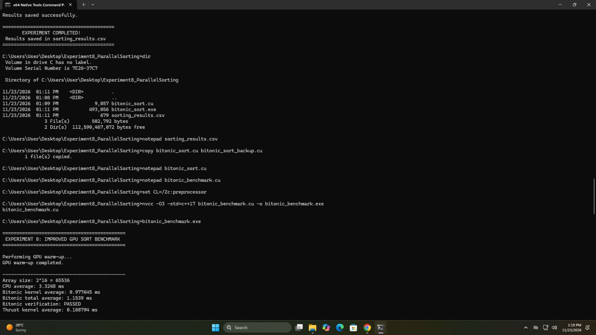
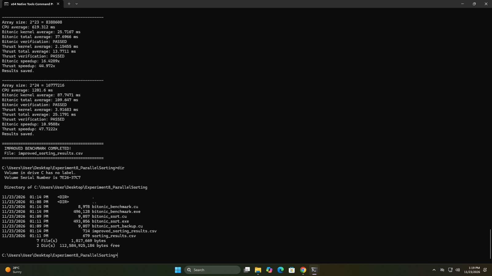
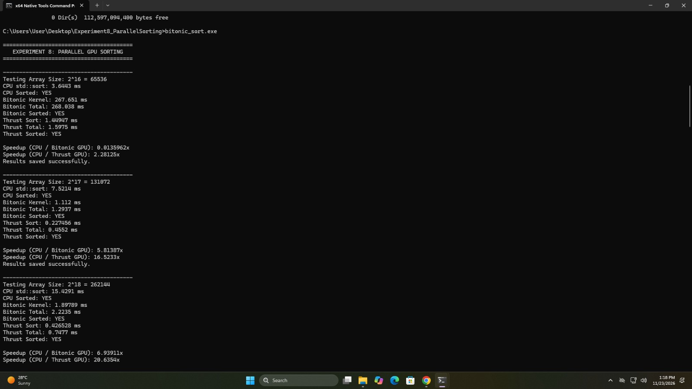
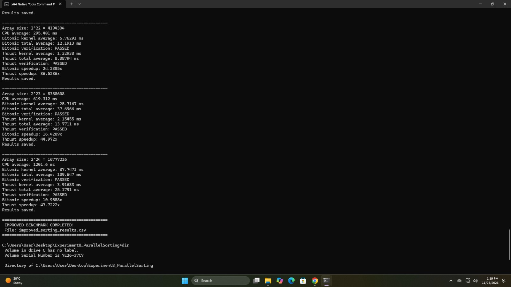
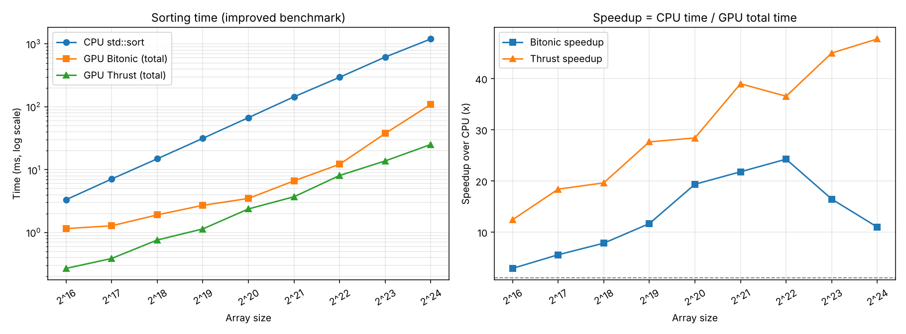

# Experiment 8 — Parallel Sorting on the GPU


---

## Table of Contents

1. [Aim](#1-aim)
2. [Tools and Setup](#2-tools-and-setup)
3. [Concepts](#3-concepts)
4. [Step-by-Step Procedure](#4-step-by-step-procedure)
5. [How the Timing Was Measured](#5-how-the-timing-was-measured)
6. [Results — Run 1 (First Version)](#6-results--run-1-first-version-bitonic_sortcu)
7. [Results — Run 2 (Improved Benchmark)](#7-results--run-2-improved-benchmark-bitonic_benchmarkcu)
8. [Graphs](#8-graphs)
9. [Analysis and Observations](#9-analysis-and-observations)
11. [Conclusion](#11-conclusion)


---

## 1. Aim

Sort **large arrays** using a **GPU bitonic sort** written in CUDA, and compare its performance with:

- a **tuned library sort** on the GPU (`thrust::sort` from the Thrust library), and
- the **CPU** (`std::sort` from the C++ standard library).

Array sizes tested: **2¹⁶ (65,536) to 2²⁴ (16,777,216)** elements.

---

## 2. Tools and Setup

| Item | Details |
|---|---|
| GPU | NVIDIA GeForce RTX 5060 Ti (16 GB VRAM) |
| Driver / CUDA | NVIDIA driver 617.14, CUDA 13.4 (`nvidia-smi`) |
| Compiler | `nvcc` from CUDA Toolkit v13.4 |
| Host compiler | MSVC `cl.exe` 14.52 (Visual Studio 2026 Community, v18.10.2) |
| OS | Windows (x64 Native Tools / Developer Command Prompt) |
| GPU timing | **CUDA events** (`cudaEvent_t`) |
| GPU library sort | **Thrust** (`thrust::sort`, ships with the CUDA Toolkit) |
| CPU baseline | `std::sort` (C++17) |




*`nvidia-smi` confirms the GPU is visible and the CUDA driver is working.*

---

## 3. Concepts

### 3.1 Why sort on a GPU?

A CPU has a few very fast cores. A GPU has **thousands of small cores** that can all work at the same time. Sorting millions of numbers involves a *lot* of independent comparisons, so a GPU can do many of them at once.

### 3.2 What is Bitonic Sort?

Bitonic sort is a sorting algorithm built from a **fixed pattern of compare-and-swap operations**. The pattern never changes, no matter what the data looks like. That makes it perfect for a GPU, because every thread knows exactly what to do without waiting for others to decide.

The big idea:

1. A **bitonic sequence** is a sequence that first goes up and then goes down (e.g. `1 4 7 9 8 5 2`).
2. If you take a bitonic sequence and repeatedly **compare elements that are a fixed distance apart and swap them if they are out of order**, you end up with a sorted sequence.
3. To sort *any* array, you first build small bitonic sequences, then merge them into bigger and bigger ones, until the whole array is sorted.

How it is organised:

- The array size must be a **power of 2** (that is why the experiment uses 2¹⁶ … 2²⁴).
- There are **log₂(n) stages**, and stage *k* has *k* **steps**.
- In every step, **n/2 independent compare-and-swap operations** happen, one per GPU thread.
- Total number of steps (kernel launches) = log₂(n) · (log₂(n)+1) / 2.

| Array size | log₂(n) | Steps (kernel passes) |
|---|---|---|
| 2¹⁶ | 16 | 136 |
| 2²⁰ | 20 | 210 |
| 2²⁴ | 24 | 300 |

Total work is **O(n · log²n)** comparisons — more than the best CPU sorts, but it is extremely parallel.

### 3.3 What is Thrust?

**Thrust** is NVIDIA's C++ template library for the GPU (like the STL, but for CUDA). `thrust::sort` is a **highly tuned** sort. For plain numbers it uses a **radix sort**, which does not even compare elements — it sorts digit by digit, which is O(n) for fixed-size keys and makes very efficient use of GPU memory. This is why it is our "tuned library" benchmark.

### 3.4 What is `std::sort` on the CPU?

The standard C++ sort (an introsort, O(n log n)) running on a **single CPU thread**. It is our baseline: "how long does a normal program take?"

### 3.5 Two kinds of GPU time

| Term | Meaning |
|---|---|
| **Kernel time** | Time spent only *inside* the GPU doing the sorting. |
| **Total time** | Kernel time **plus** copying the array from CPU memory to GPU (Host→Device) and the sorted result back (Device→Host). |

Copying across the PCIe bus is not free, so **total time is the fair number** to compare against the CPU — the CPU does not need to copy anything.

---

## 4. Step-by-Step Procedure

### Step 1 — Open the right terminal

Open **"x64 Native Tools Command Prompt for VS"** (or the *Developer Command Prompt*) from the Start menu.
A normal Command Prompt will not work because `nvcc` needs `cl.exe` (the Microsoft C++ compiler) on the PATH.

### Step 2 — Check the GPU is working

```bat
nvidia-smi
```

You should see your GPU name (RTX 5060 Ti) and the CUDA version. Also confirm the compiler is found:

```bat
where cl
```

Expected: a path ending in `...\bin\Hostx64\x64\cl.exe`.

### Step 3 — Create the project folder on the Desktop


```bat
cd /d "%USERPROFILE%\Desktop"
mkdir Experiment8_ParallelSorting
cd Experiment8_ParallelSorting
```



### Step 4 — Write the CUDA program

```bat
notepad bitonic_sort.cu
```

Paste the code (CPU `std::sort`, bitonic kernel, `thrust::sort`, CUDA-event timing, verification, CSV output) and save.

### Step 5 — Fix the preprocessor setting (needed with the newest CUDA + MSVC)

```bat
set CL=/Zc:preprocessor
```

This tells MSVC to use the modern, standard-conforming preprocessor that newer CUDA headers require.

### Step 6 — Compile

```bat
nvcc -O3 -std=c++17 bitonic_sort.cu -o bitonic_sort.exe
```

| Flag | Meaning |
|---|---|
| `-O3` | Maximum optimisation |
| `-std=c++17` | Use the C++17 standard |
| `-o bitonic_sort.exe` | Name of the output program |

Check that the exe was created:

```bat
dir bitonic_sort.exe
```

(About 493 KB.)



### Step 7 — Run Version 1

```bat
bitonic_sort.exe
```

The program tests every size from 2¹⁶ to 2²⁴ and prints a block of results for each, then saves `sorting_results.csv`.

### Step 8 — Look at the results and make a backup

```bat
notepad sorting_results.csv
copy bitonic_sort.cu bitonic_sort_backup.cu
```

### Step 9 — Build the improved benchmark

The first run showed a suspicious spike at 2¹⁶ . To get fair numbers, I wrote `bitonic_benchmark.cu`, which adds a **warm-up** and **averaging**:

```bat
notepad bitonic_benchmark.cu
set CL=/Zc:preprocessor
nvcc -O3 -std=c++17 bitonic_benchmark.cu -o bitonic_benchmark.exe
```

### Step 10 — Run the improved benchmark

```bat
bitonic_benchmark.exe
```

This prints "Performing GPU warm-up…", then the averaged results for every size, and saves `improved_sorting_results.csv`.



### Step 11 — Confirm the output files

```bat
dir
```

You should see both `.exe` files and both `.csv` files.



---

## 5. How the Timing Was Measured

- **CPU time** — measured around the `std::sort` call.
- **GPU time** — measured with **CUDA events**. The GPU runs asynchronously, so a normal CPU timer would be wrong; CUDA events are timestamps recorded *on the GPU itself*:
  1. `cudaEventRecord(start)`
  2. run the work
  3. `cudaEventRecord(stop)` and `cudaEventSynchronize(stop)`
  4. `cudaEventElapsedTime(&ms, start, stop)`
- **Kernel time** — only the sorting step. **Total time** — copy-in + sorting + copy-out.
- **Verification** — every result is checked to be in non-decreasing order before it is trusted.

The two versions differ like this:

| | Version 1 (`bitonic_sort.cu`) | Version 2 (`bitonic_benchmark.cu`) |
|---|---|---|
| GPU warm-up | No | **Yes** |
| Runs per size | 1 | **Several, averaged** |
| Output file | `sorting_results.csv` | `improved_sorting_results.csv` |

---

## 6. Results — Run 1 (First Version, `bitonic_sort.cu`)

All times are in **milliseconds (ms)**. Every CPU, Bitonic, and Thrust output was reported as **sorted = YES**.

| Array size | n | CPU `std::sort` | Bitonic kernel | Bitonic total | Thrust sort | Thrust total | Speedup CPU/Bitonic | Speedup CPU/Thrust |
|---|---|---|---|---|---|---|---|---|
| 2¹⁶ | 65,536 | 3.6443 | 267.651 | 268.038 | 1.44947 | 1.5975 | **0.0136×** | 2.28× |
| 2¹⁷ | 131,072 | 7.5214 | 1.112 | 1.2937 | 0.227456 | 0.4552 | 5.81× | 16.52× |
| 2¹⁸ | 262,144 | 15.4291 | 1.89789 | 2.2235 | 0.426528 | 0.7477 | 6.94× | 20.64× |
| 2¹⁹ | 524,288 | 32.1494 | 2.21709 | 2.6853 | 0.589792 | 1.0588 | 11.97× | 30.36× |
| 2²⁰ | 1,048,576 | 67.5825 | 2.46013 | 3.2844 | 0.87072 | 1.6816 | 20.58× | 40.19× |
| 2²¹ | 2,097,152 | 142.606 | 4.0953 | 5.6196 | 1.78874 | 3.3304 | 25.38× | 42.82× |
| 2²² | 4,194,304 | 289.907 | 7.05584 | 9.6982 | 1.61453 | 4.2832 | 29.89× | 67.68× |
| 2²³ | 8,388,608 | 607.96 | 16.0907 | 21.1004 | 2.15635 | 7.5695 | 28.81× | 80.32× |
| 2²⁴ | 16,777,216 | 1165.7 | 86.0246 | 97.1913 | 3.77469 | 15.3652 | 11.99× | 75.87× |

Screenshots: [2¹⁶–2¹⁸](screenshots/04_first_run_2e16_to_2e18.jpeg) · [2¹⁸–2²¹](screenshots/05_first_run_2e18_to_2e21.jpeg) · [2²²–2²⁴](screenshots/06_first_run_2e22_to_2e24.jpeg)



---

## 7. Results — Run 2 (Improved Benchmark, `bitonic_benchmark.cu`)

Each value is an **average** after a **GPU warm-up**. Every Bitonic and Thrust result printed **verification: PASSED**.

| Array size | n | CPU avg | Bitonic kernel avg | Bitonic total avg | Thrust kernel avg | Thrust total avg | Bitonic speedup | Thrust speedup |
|---|---|---|---|---|---|---|---|---|
| 2¹⁶ | 65,536 | 3.3248 | 0.977645 | 1.1539 | 0.108794 | 0.2683 | 2.88× | 12.39× |
| 2¹⁷ | 131,072 | 7.09654 | 1.05192 | 1.27884 | 0.130714 | 0.3864 | 5.55× | 18.37× |
| 2¹⁸ | 262,144 | 14.8892 | 1.47897 | 1.90642 | 0.368499 | 0.75978 | 7.81× | 19.60× |
| 2¹⁹ | 524,288 | 31.5023 | 1.95884 | 2.70768 | 0.482067 | 1.14102 | 11.63× | 27.61× |
| 2²⁰ | 1,048,576 | 67.279 | 2.06161 | 3.48198 | 0.805811 | 2.3709 | 19.32× | 28.38× |
| 2²¹ | 2,097,152 | 144.426 | 3.83974 | 6.63608 | 0.931674 | 3.7065 | 21.76× | 38.97× |
| 2²² | 4,194,304 | 295.401 | 6.76291 | 12.1913 | 1.32938 | 8.08794 | 24.23× | 36.52× |
| 2²³ | 8,388,608 | 619.312 | 25.7167 | 37.6966 | 2.15455 | 13.7711 | 16.43× | 44.97× |
| 2²⁴ | 16,777,216 | 1201.6 | 87.7471 | 109.647 | 3.91683 | 25.1791 | 10.96× | 47.72× |

Screenshots: [2¹⁶–2¹⁹](screenshots/08_improved_2e16_to_2e19.jpeg) · [2¹⁹–2²²](screenshots/09_improved_2e19_to_2e22.jpeg) · [2²²–2²⁴ + completion](screenshots/10_improved_2e22_to_2e24.jpeg)



Run 2 ended with:

```
IMPROVED BENCHMARK COMPLETED!
File: improved_sorting_results.csv
```

---

## 8. Graphs



- **Left:** time (log scale) for the CPU, GPU Bitonic (total), and GPU Thrust (total). Both GPU lines stay below the CPU line for every size.
- **Right:** speedup over the CPU. Thrust keeps climbing; Bitonic rises, peaks at 2²², then falls.

---

## 9. Analysis and Observations

### 9.1 Why was Run 1 so slow at 2¹⁶ (267 ms)?

The very first CUDA call in a program has to **create the CUDA context, initialise the driver, and load the kernel onto the GPU**. In Run 1, the first thing timed was the bitonic kernel at 2¹⁶, so it paid that one-time cost (≈ 267 ms), making the speedup look like **0.0136×** (the GPU looked 70× *slower* than the CPU). By 2¹⁷ the GPU was "warm" and the same kernel on twice the data took just **1.1 ms**.

**Fix in Run 2:** a **warm-up** run before timing, plus averaging. The 2¹⁶ bitonic kernel dropped from **267.651 ms → 0.978 ms**, and the speedup went from 0.0136× to **2.88×**.


### 9.2 The GPU wins at every size

With warm-up, both GPU methods are faster than the CPU for **all** sizes from 2¹⁶ to 2²⁴. At 2²⁴ (≈ 16.8 million elements):

- CPU: **1201.6 ms** (about 1.2 seconds)
- Bitonic GPU: **109.6 ms** → **10.96× faster**
- Thrust GPU: **25.2 ms** → **47.72× faster**

### 9.3 Thrust beats the hand-written Bitonic sort

At every size, `thrust::sort` is faster than the bitonic sort. Reasons:

1. **Different algorithm.** Thrust uses a radix sort (≈ O(n) work for fixed-size keys); bitonic sort does O(n·log²n) comparisons.
2. **Memory traffic.** Each bitonic step is a separate pass over the data in global memory (300 passes at 2²⁴). Thrust is carefully tuned to read/write memory far fewer times.
3. **Years of tuning.** Thrust's kernels are heavily optimised by NVIDIA (shared-memory use, coalesced access, etc.).

At 2²⁴, the *kernel-only* gap is huge: **87.7 ms (bitonic) vs 3.9 ms (Thrust)** — about **22× faster** for Thrust.

### 9.4 Bitonic speedup peaks at 2²² and then drops

| Size | Bitonic speedup (Run 2) |
|---|---|
| 2²¹ | 21.76× |
| **2²²** | **24.23× (peak)** |
| 2²³ | 16.43× |
| 2²⁴ | 10.96× |

This is expected: bitonic sort's work grows as **n·log²n**, and once the array no longer fits comfortably in the GPU's cache, every extra step becomes a full trip to slow global memory. The bitonic **kernel time jumps ~13×** from 2²² to 2²⁴ (6.76 ms → 87.7 ms) even though the data is only 4× bigger, while the CPU time grows roughly 4×. So the advantage shrinks. Thrust does not suffer from this, so its speedup keeps rising.

### 9.5 Data-transfer cost (kernel vs. total)

The gap between *total* and *kernel* time is the cost of copying over PCIe:

| Size | Bitonic: total − kernel | Thrust: total − kernel |
|---|---|---|
| 2¹⁶ | 0.18 ms | 0.16 ms |
| 2²⁰ | 1.42 ms | 1.57 ms |
| 2²² | 5.43 ms | 6.76 ms |
| 2²⁴ | **21.90 ms** | **21.26 ms** |

- The copy cost is almost **identical** for both methods (same amount of data moved) and grows linearly with n.
- For **Thrust at 2²⁴**, the kernel takes only 3.9 ms but copying takes ~21 ms — i.e. **~84 % of its total time is data transfer**. The sort itself is so fast that the PCIe copy dominates. Sorting on the GPU pays off most when the data already lives on the GPU or is reused for further GPU work.

### 9.6 Run 1 vs Run 2 — are the numbers consistent?

Mostly yes. CPU times agree within a few percent (e.g. 2²⁰: 67.58 vs 67.28 ms). The bigger differences (for example Thrust total at 2²⁴: 15.4 ms vs 25.2 ms) come from Run 1 being a **single sample** while Run 2 is an **average**, and from normal run-to-run variation (memory allocation, clocks, background processes). Run 2 is the more trustworthy set, and it is the one used for the graphs and conclusions.

---


## 11. Conclusion

- A **GPU bitonic sort** was implemented in CUDA and compared against **`thrust::sort`** and the CPU's **`std::sort`** for sizes **2¹⁶ to 2²⁴**; all outputs were verified as correctly sorted.
- After a GPU warm-up and averaging, the GPU was faster than the CPU at **every** size.
- **Bitonic sort** reached a best speedup of **≈ 24.2×** (at 2²²) and **≈ 11×** at 2²⁴.
- **Thrust sort** was the clear winner, reaching **≈ 47.7×** at 2²⁴ (25.2 ms vs 1201.6 ms on the CPU), because it uses an efficient radix sort with heavily optimised memory access.
- Bitonic sort's speedup falls at large sizes due to its **O(n·log²n)** work and many global-memory passes.
- **Data transfer** between CPU and GPU takes a large share of the total time (up to ~84 % for Thrust at 2²⁴).
- **Benchmarking lesson:** the first GPU call is slow (context start-up); always **warm up** and **average** several runs.
---

